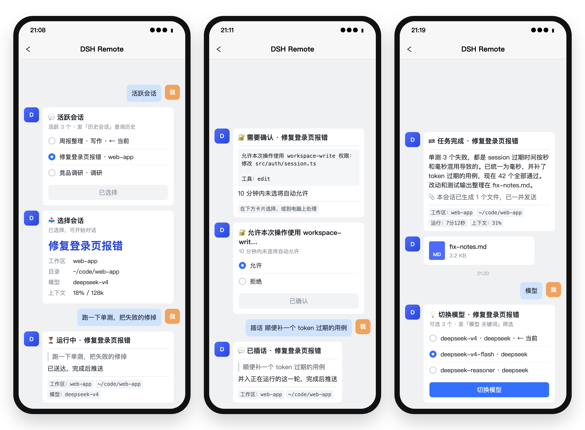
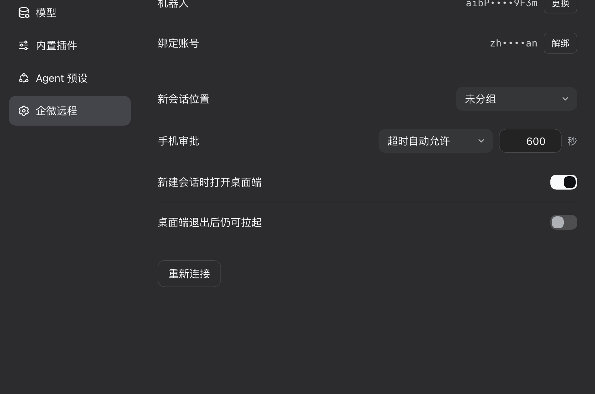

# dsh-remote-wecom

[](https://www.npmjs.com/package/dsh-remote-wecom)
[](LICENSE)

> Control DeepSeek Harness Desktop sessions from WeCom (企业微信) on your phone: send prompts, get results and files back, approve tool calls, switch sessions and models. Docs and commands are in Chinese.

在手机企业微信里遥控 DeepSeek Harness Desktop：发消息、收结果、切会话和模型、审批与回答提问、取回产物。插件跑在 Desktop 里，自己持有企微智能机器人的长连接。



- 任务跑完自动推结果，生成的文件一并发到手机
- 审批和提问同时发到手机和 Desktop，哪边先答用哪边
- 运行中可以插话、停止，也能设长期目标让它自己续跑
- 引用某条推送回复，消息就发回那个会话，多个任务并行不串
- Desktop 没开也能发：消息先暂存，后台拉起 Desktop 后自动处理（macOS）

## 要求

- DeepSeek Harness Desktop（DSH `>=0.2.0-rc.2`）
- Node.js `>=22.19.0`（命令行用）
- 一个专用的企业微信智能机器人。同一个机器人只能有一条长连接，不要与其他程序共用

## 安装

Desktop 运行时会锁住 `desktop` profile，`dsh plugin add` 用不了，需要手动加：

1. 退出 Desktop。
2. 在 `~/.dsh/profiles/desktop/package.json` 里追加（保留已有条目）：

   ```json
   {
     "dependencies": { "dsh-remote-wecom": "^0.1.2" },
     "dsh": { "profile": { "bundles": ["…", "dsh-remote-wecom"] } }
   }
   ```

3. 安装并启动：

   ```sh
   cd ~/.dsh/profiles/desktop
   node "/Applications/DeepSeek Harness.app/Contents/Resources/runtime/primary-runtime/dependencies/pnpm/bin/pnpm.mjs" install
   open -a "DeepSeek Harness"
   ```

升级时改版本号，再重复第 3 步。

也可以把下面这段发给 Agent（Claude Code、Cursor、pi 等）代装：

```text
按 https://github.com/lukeinx/dsh-remote-wecom 的 README 给我的 DeepSeek Harness Desktop 安装 dsh-remote-wecom，
遵守「让 Agent 代装」一节的规则；装好后提醒我到「设置 → 企微远程」扫码绑定。
```

## 绑定

打开 Desktop「设置 → 企微远程」：



1. 用企业微信扫码，自动创建机器人并连接。
2. 10 分钟内给机器人发一条单聊消息，发送人即成为主人；过了窗口就发页面上的 6 位绑定码。之后只接主人的单聊。

同一页可以换机器人、解绑、选新会话位置、设置手机审批超时。扫不了码时可以手动填 BotID / Secret。

打开「桌面端退出后仍可拉起」（macOS）：Desktop 没开时，手机发来的消息先暂存，并在后台启动 Desktop，启动后自动处理。移除插件前先关掉它。

## 手机上用

选中会话后直接发消息；引用某条推送回复，消息会发给该推送所属的会话。图片和文件可以先发，5 分钟内再补说明。任务完成后自动推送结果；审批和提问同时出现在手机和 Desktop，谁先答用谁的。

| 命令 | 作用 |
|---|---|
| `活跃会话` / `ls` | 切换到运行中、置顶或最近活跃的会话 |
| `历史会话 [关键词]` / `h` | 查找并继续历史会话 |
| `创建会话 [工作区] [消息]` / `n` | 新建会话并发送首条消息 |
| `工作区 [名称]` / `cd` | 选择新会话的默认位置 |
| `插话 内容` / `steer` | 插进正在运行的这一轮 |
| `目标 [描述]` / `goal` | 设置长期目标，自动续跑到完成 |
| `模型 [关键词]` / `model` | 切换模型 |
| `思考强度 [强度]` / `think` | 切换思考强度 |
| `权限模式 [模式]` / `perm` | 切换当前会话的权限模式 |
| `压缩` / `compact` | 压缩当前会话上下文 |
| `产物` / `art` | 取回当前会话生成的文件 |
| `关注` / `取关` | 电脑上发起的任务也推到手机 / 只推手机发起的 |
| `状态` / `停止` / `重启` / `帮助` | 查看状态、中断任务、重连、查看全部命令 |

中文命令和参数之间要有空格：`模型 high` 是命令，`模型high` 会当普通消息发出。

## 命令行

设置页之外的备用入口：

```sh
alias dsh-remote-wecom='node ~/.dsh/profiles/desktop/node_modules/dsh-remote-wecom/bin/dsh-remote.mjs'
```

| 命令 | 作用 |
|---|---|
| `setup [--bot-id ID --secret S]` | 写入机器人凭证并生成绑定码 |
| `bind` | 解除当前主人，生成新绑定码 |
| `status` | 查看配置、绑定状态和最近日志 |
| `alias [名称 目录 \| rm 名称]` | 管理目录别名，供「创建会话」「工作区」使用 |
| `watchdog install\|uninstall\|status` | 「桌面端退出后仍可拉起」的开关与状态 |

数据在 `~/.dsh/integrations/dsh-remote-wecom/`，`config.json` 权限为 600。可选配置和实现细节见 [docs/DESIGN.md](docs/DESIGN.md)。

## 让 Agent 代装

- 改 profile 前先退出 Desktop，只追加条目，不动已有的 `dependencies` 和 `bundles`。
- 扫码和绑定由用户在手机上完成；不读取、不打印 Secret。
- 用 `dsh-remote-wecom status` 验证：出现 `Secret：已配置` 和 `主人：已绑定` 即完成。
- 改本仓库代码前先读 [AGENTS.md](AGENTS.md)。

## 开发

```sh
git clone https://github.com/lukeinx/dsh-remote-wecom.git && cd dsh-remote-wecom
npm install
npm run check      # 打包设置页 + 语法检查 + 单元测试
npm run test:e2e   # 隔离的 DSH + 假企微，约 30 秒
```

本地调试时把 profile 里的依赖改成 `"dsh-remote-wecom": "link:<仓库绝对路径>"`，改完代码重启 Desktop。

## 许可

MIT，见 [LICENSE](LICENSE) 与 [NOTICE.md](NOTICE.md)。
